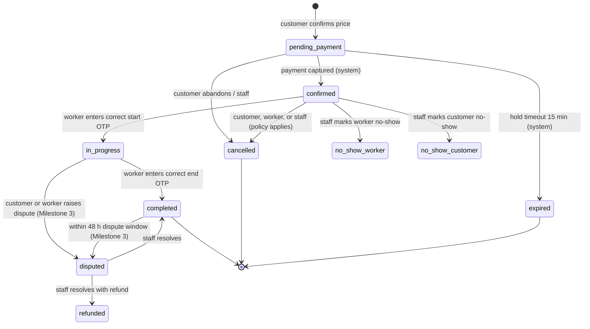
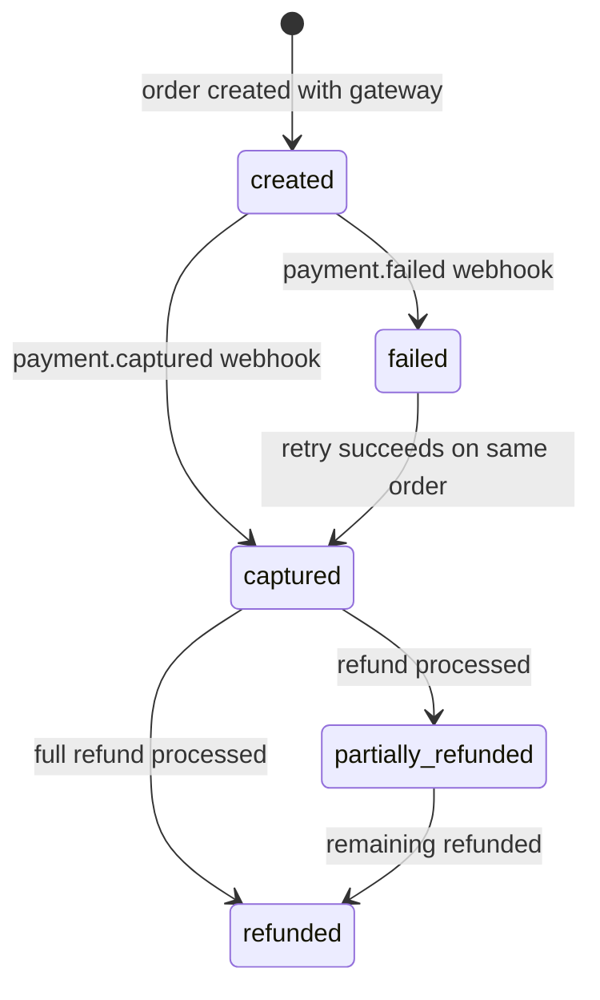

# Booking lifecycle and state machines

Status: Specification Complete. Booking, assignment and payment machines are implemented in Milestone 1; service requests, quotes and team bookings in Milestone 2; the rest are specified for later milestones. Last updated 28 October 2026.

**Built in Milestone 1:** create, payment capture, hold expiry, start, finish, and cancellation by customer, worker (including "I feel unsafe", without penalty) or staff with the policy fee and a cancellation journal. **Not built yet (Milestone 3):** marking no-shows, worker strikes, alerting ops and finding a replacement after a worker cancels, refund execution, disputes. Rows below marked (M3) describe that target behaviour.

Every transition is executed by a domain service inside a database transaction, writes an event row (for example `booking_events`) and an `audit_log` entry, and is rejected if the current state does not allow it. "System" means a verified webhook or a scheduled job. "Staff" means admin or ops unless stated.

## 1. Booking (direct booking, Milestone 1)

| From | To | Trigger | Who | Guards | Side effects |
|---|---|---|---|---|---|
| (none) | pending_payment | create booking | customer | phone verified; code of conduct accepted; service active in city and feature flag on; lead time, min/max duration, allowed hours met; worker eligible and available (re-checked under row lock); client's expected total equals server price | Assignment row (exclusion constraint), price snapshot, payment order, 15-minute hold |
| pending_payment | confirmed | payment captured | system | webhook signature valid; amount equals `total_paise`; booking still pending | Payment captured, capture journal, start and end OTP generated, notifications to both parties |
| pending_payment | expired | hold timeout | system | `hold_expires_at` passed | Assignment released |
| pending_payment | cancelled | abandon | customer, staff | no captured payment | Assignment released |
| confirmed | in_progress | start | assigned worker | start OTP matches; within 60 minutes before to 120 minutes after scheduled start (config); fewer than 5 failed attempts | `started_at` set |
| confirmed | cancelled | cancel | customer | cancellation policy computes fee (free above 24 h, 50% from 24 h to 2 h, 100% under 2 h) | Assignment released; refund journal for refundable part (refund execution Milestone 3) |
| confirmed | cancelled | decline after confirm (alert and replacement are M3) | worker | allowed without penalty when the worker reports feeling unsafe; otherwise counted | Assignment released; ops alerted to find a replacement; full refund |
| confirmed | cancelled | cancel | staff | reason required | As above |
| confirmed | no_show_worker | mark (M3) | staff | after start window | Full refund, worker strike, ops replacement attempt (Milestone 3) |
| confirmed | no_show_customer | mark (M3) | staff, worker (with evidence) | after start window plus 30 minutes | 100% fee per policy |
| in_progress | completed | finish | assigned worker | end OTP matches | `completed_at`, completion journal (worker earnings, commission, taxes), rating requests to both parties |

OTP rules: 4-digit codes generated with a cryptographic RNG, stored as HMAC hashes, shown only to the customer in their booking page and notifications. Five failed attempts lock OTP entry and alert ops.

## 2. Booking assignment

| From | To | Trigger | Who |
|---|---|---|---|
| (none) | active | booking created or quote accepted | system (inside booking transaction) |
| active | released | booking expired, cancelled, no-show, or reassigned | system, staff |

Only `active` rows take part in the overlap constraint. Reassignment releases the old row and inserts a new one.

**Team bookings (Milestone 2).** A booking pays for `workers_needed` places, each an `active` assignment. Fewer active assignments than places is a partial fill: visible to ops, shown to the customer, and the job cannot start until it is fixed. Ops assign or take people off before the start (`booking.assign`). A worker who cancels a team booking releases only their own assignment. Completion pays each assigned person the snapshot's per-person net.

## 3. Payment

| Transition | Who | Guards | Effect |
|---|---|---|---|
| created | system (inside booking creation) | amount equals snapshot total | `payments` row, provider order id |
| created to captured | system (webhook) | signature valid; event id unseen; amount and order match | capture journal: debit `gateway_clearing`, credit `customer_funds_held` |
| created to failed | system (webhook) | signature valid | none; customer may retry until hold expires |
| captured to refunded or partially_refunded | system (refund webhook, Milestone 3) | refund amount within captured minus already refunded | refund journal |

Idempotency: `payment_webhook_events (provider, event_id)` is unique, `payments.provider_payment_id` is unique, and each journal has a unique `idempotency_key` (for example `capture:<payment_id>`). A replayed webhook is acknowledged with 200 and changes nothing.

## 4. Ledger journals

| Kind | When | Lines (paise) |
|---|---|---|
| `capture` | payment captured | Dr gateway_clearing = total; Cr customer_funds_held = total |
| `completion` | booking completed | Dr customer_funds_held = total; Cr worker_payable[worker] = net earning; Cr commission_revenue = commission; Cr gst_output_payable = GST on commission + GST on platform fee; Cr platform_fee_revenue = platform fee; Cr tds_payable = TDS (0 until CA confirms) |
| `cancellation` | cancelled after capture (Milestone 3) | Dr customer_funds_held = total; Cr refunds_payable = refundable; Cr worker_payable / cancellation_fee_revenue = fee split per policy |
| `refund` | refund processed (Milestone 3) | Dr refunds_payable; Cr gateway_clearing |
| `payout` | payout processed (Milestone 3) | Dr worker_payable; Cr payout_clearing |

The price snapshot stored on the booking lists exactly these amounts, so the price shown, the snapshot and the ledger agree by construction and by test.

## 5. Service request (assisted matching, Milestone 2)

`submitted` to `in_review` (ops picks up) to `sourcing` (ops contacting providers) to `quoted` (one or more quotes sent) to `accepted` (customer accepts a quote, booking created) or `declined` (customer) or `expired` (no acceptance before deadline) or `cancelled` (customer or ops). Each request has an owner, a first-response deadline (2 business hours, config) and assignment history.

Built in Milestone 2. Allowed transitions, enforced by a trigger as well as the service: submitted to in_review, sourcing or quoted; in_review to sourcing or quoted; sourcing to in_review or quoted; quoted to in_review (customer asks for changes, or ops withdraws the quote), accepted (payment captured, system) or declined; any open status to cancelled (customer or staff, reason required) or expired (system: the sent quote expired, or the start time passed); expired to in_review (staff reopen, only if the job is more than an hour away). Every change writes a `service_request_events` row (append-only) and an audit entry. The first move out of `submitted` by staff records the first response.

## 6. Quote (Milestone 2)

`draft` (ops) to `sent` (ops) to `accepted` (customer, before expiry; creates booking with snapshot), `change_requested` (customer, returns to `draft` as a new version), `declined` (customer) or `expired` (system after 48 hours, config). Accepted quotes are immutable.

Built in Milestone 2, with one more status: `withdrawn` (ops takes back a draft or sent quote). At most one draft or sent quote per request (unique index). A sent quote cannot be edited (trigger); a quote that has left draft or sent never changes. Accepting creates a `pending_payment` booking at the quote's exact snapshot and assigns the proposed people who are still free; the quote and request become `accepted` in the same transaction as the payment capture. Expiry is checked before every read and action, and by the daily sweep; a quote whose payment window is still open is not expired until that window closes.

## 7. Refund (Milestone 3)

`requested` (customer, system on policy, or staff) to `approved` (finance or rule) to `processing` (gateway call) to `succeeded` or `failed` (webhook). Failed refunds go back to `approved` for retry. Partial refunds are separate refund rows.

## 8. Payout (Milestone 3)

`scheduled` (weekly job, only for earnings older than the 48-hour dispute window with no open dispute) to `processing` to `paid` or `failed` (provider webhook). Failed payouts return to `scheduled` after the worker fixes bank details. Held payouts (`on_hold`) are set by finance during disputes.

## 9. Incident (Milestone 3)

`open` (SOS, report or complaint, with severity P1 to P4) to `acknowledged` (ops, SOS target 2 minutes) to `investigating` to `resolved` or `escalated` (to admin or authorities). Every incident has an owner, a response deadline by severity, and an audit trail. Closure requires a resolution note.

## 10. Dispute (Milestone 3)

`raised` (customer or worker within 48 hours of completion) to `under_review` (ops) to `resolved_no_change`, `resolved_partial_refund` or `resolved_full_refund` (ops with finance approval above a configurable amount). Payouts for the booking stay on hold while a dispute is open.
