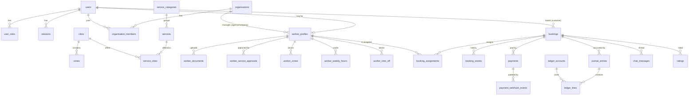

# Database design

Status: Specification Complete for Milestones 0 to 2; later entities are outlined. Last updated 28 October 2026.

Engine: PostgreSQL 17. Extensions: `pgcrypto` (UUIDs), `btree_gist` (exclusion constraints). Schema source of truth: `src/modules/*/schema.ts` (Drizzle) plus hand-written SQL in `drizzle/` for roles, RLS policies, triggers and constraints Drizzle cannot express.

## 1. Conventions

- Primary keys are `uuid` (`gen_random_uuid()`), except lookup tables keyed by a stable slug.
- All timestamps are `timestamptz`, stored in UTC. Display converts to Asia/Kolkata.
- Money is `bigint` paise in columns ending `_paise`. There are no floating point money columns anywhere.
- Rates are integer basis points in columns ending `_bps` (2000 bps = 20%).
- Status columns are `text` with a `CHECK` constraint listing allowed values. Transitions are enforced in services (see [booking-lifecycle.md](booking-lifecycle.md)) and recorded in event tables.
- Soft deletion only where the law or audit needs history. Personal data deletion follows the retention schedule in [security-privacy-and-safety.md](security-privacy-and-safety.md).
- Every table that holds personal or financial data has RLS enabled and forced.

## 2. Entity relationship overview



## 3. Tables (Milestones 0 and 1)

### Identity and access (M02)

| Table | Key columns | Notes |
|---|---|---|
| `users` | id, phone_e164 (unique), phone_verified_at, display_name, email, gender (optional, self-declared), status (`active`, `suspended`, `deleted`), created_at | One account per phone number. A user can hold several roles. There is no separate customer profile table in Milestone 1; customer fields live on `users`. |
| `user_roles` | user_id, role, organisation_id (nullable), granted_by, granted_at; unique (user_id, role, organisation_id) | Roles: `customer`, `worker`, `admin`, `ops`, `verifier`, `finance`, `support`, `agency_admin`, `corporate_admin`. |
| `organisations` | id, kind (`platform`, `agency`, `corporate`), name, status, gstin (nullable) | Company-managed workers belong to the `platform` organisation. |
| `organisation_members` | organisation_id, user_id, member_role | Agency and corporate users. Used by RLS for org isolation from Milestone 5. |
| `otp_challenges` | id, phone_e164, purpose, code_hash, expires_at, attempts, consumed_at, created_at | Code is HMAC-SHA256 with a server pepper. Never stored in plain text. |
| `sessions` | id, user_id, token_hash (unique), expires_at, created_at, last_seen_at, user_agent | Token is 32 random bytes; only its SHA-256 hash is stored. |
| `consents` | id, user_id, purpose, version, granted_at, withdrawn_at | DPDP consent records and code of conduct acceptance (`purpose = 'code_of_conduct'`). |
| `audit_log` | id, at, actor_user_id, actor_roles, action, entity_type, entity_id, request_id, data (jsonb, redacted) | Append-only: a trigger rejects UPDATE and DELETE. |
| `rate_limits` | key, window_start, count; primary key (key, window_start) | Fixed-window counters. |

### Geography and catalogue (M01, M03)

| Table | Key columns | Notes |
|---|---|---|
| `cities` | id, slug (unique), name, state, region (`delhi-ncr`, `mumbai`), status (`configured`, `live`, `paused`) | Delhi, Noida, Gurugram, Mumbai seeded. |
| `zones` | id, city_id, slug, name; unique (city_id, slug) | For example South Delhi, Noida Sector 62, Andheri. |
| `localities` | id, city_id, zone_id, slug, name, lat, lng; unique (city_id, slug) | Neighbourhoods with approximate centre points for distance matching (T-45). Public read, admin write. |
| `service_categories` | id, slug, name, risk_tier (`A`, `B`, `C`), sort_order | |
| `services` | id, category_id, slug (unique), name, summary, risk_tier, booking_mode (`direct`, `assisted`, `both`), pricing_model (`hourly`, `daily`, `fixed`, `quote`), config (jsonb, Zod-validated `ServiceConfig`), feature_flag_key, status (`draft`, `active`, `disabled`) | Config holds durations, lead time, allowed hours, workers required, location rules, booking questions, required documents, verification level, minimum rating, customer verification, matching mode, cancellation policy, payment rule, safety rules. |
| `service_cities` | id, service_id, city_id, status (`waitlist`, `live`, `paused`), pricing (jsonb, Zod `PricingConfig`), pricing_version (int), go_live_min_workers (int); unique (service_id, city_id) | Price edits bump `pricing_version`. Confirmed bookings keep their own snapshot. |
| `feature_flags` | key, enabled, description, updated_by, updated_at | `category.social-companion` is seeded disabled. |
| `config_values` | key, scope (`global`, `city:<slug>`, `service:<slug>`), value (jsonb), status (`approved`, `pending_signoff`), updated_by | Business defaults from section 16. |

### Workers (M04, M05)

| Table | Key columns | Notes |
|---|---|---|
| `worker_profiles` | id, user_id (unique), workforce_model (`independent`, `company`, `agency`), organisation_id, bio, languages (text[]), gender, years_experience, home_city_id, status (`applicant`, `active`, `suspended`), kyc_status, kyc_provider_ref, id_number_masked, photo_status, rating_avg_x100, rating_count, search_opt_in, base_locality_id, base_lat, base_lng (home base, about 1 km precision, never exposed), travel_radius_km (1 to 50, default 10) | No full Aadhaar or ID numbers. |
| `worker_documents` | id, worker_id, doc_type (`driving_licence`, `police_certificate`, `id_proof`, `selfie`, `profile_photo`), status (`pending`, `approved`, `rejected`, `expired`), number_masked, issued_on, expires_on, attributes (jsonb, e.g. vehicle classes), storage_key, sha256, reviewed_by, reviewed_at, review_note | File is AES-256-GCM encrypted at rest. Every read writes an audit entry. |
| `worker_service_approvals` | id, worker_id, service_id, status (`applied`, `approved`, `rejected`, `suspended`), reason, reviewed_by, reviewed_at; unique (worker_id, service_id) | Approval is per service, never global. |
| `worker_zones` | worker_id, zone_id | Service area. |
| `worker_weekly_hours` | id, worker_id, weekday (0 to 6, Monday = 0), start_minute, end_minute | Local Asia/Kolkata wall-clock minutes. |
| `worker_time_off` | id, worker_id, starts_at, ends_at, reason | Blocks availability. |

### Bookings (M07)

| Table | Key columns | Notes |
|---|---|---|
| `bookings` | id, ref (unique human code), customer_user_id, service_id, city_id, zone_id, locality_id, job_lat, job_lng (job location, about 100 m precision), status, starts_at, ends_at, address_line, landmark, answers (jsonb), price_snapshot (jsonb), total_paise, pricing_version, workers_needed (1 to 50, default 1), hold_expires_at, start_otp_hash, end_otp_hash, otp_failed_attempts, started_at, completed_at, cancelled_at, cancelled_by, cancel_reason, created_at, updated_at | Status values in [booking-lifecycle.md](booking-lifecycle.md). |
| `booking_assignments` | id, booking_id, worker_id, status (`active`, `released`), slot (tstzrange), created_at | Exclusion constraint below prevents double booking. |
| `booking_events` | id, booking_id, from_status, to_status, actor_user_id, actor_role, at, data | Full status history. |

Double-booking guard:

```sql
ALTER TABLE booking_assignments
  ADD CONSTRAINT booking_assignments_no_overlap
  EXCLUDE USING gist (worker_id WITH =, slot WITH &&) WHERE (status = 'active');
```

The booking transaction also locks the worker row (`SELECT ... FOR UPDATE`) and expires stale payment holds for that worker before inserting, so a stale hold never blocks a real booking.

### Payments and ledger (M13)

| Table | Key columns | Notes |
|---|---|---|
| `payments` | id, booking_id, provider, mode (`sandbox`, `live`), provider_order_id (unique), provider_payment_id (unique, nullable), amount_paise, status (`created`, `captured`, `failed`, `refunded`), captured_at | |
| `payment_webhook_events` | id, provider, event_id, signature_valid, payload (jsonb), received_at, processed_at, result; unique (provider, event_id) | Replays hit the unique key and are acknowledged without effect. |
| `ledger_accounts` | id, code, owner_type, owner_id, name; unique (code, owner_id) | Codes: `gateway_clearing` (asset), `customer_funds_held` (liability), `worker_payable` (liability, per worker), `commission_revenue`, `platform_fee_revenue` (revenue), `gst_output_payable`, `tds_payable` (liability), `refunds_payable` (liability). |
| `journal_entries` | id, kind, booking_id, payment_id, memo, idempotency_key (unique), created_at, created_by | |
| `ledger_lines` | id, journal_id, account_id, debit_paise, credit_paise | `CHECK` exactly one side positive. A deferred constraint trigger checks that each journal's debits equal its credits at commit. |

There is no balance column anywhere. Balances are `SUM(credit) - SUM(debit)` (or the reverse for assets) over `ledger_lines`.

### Communication, quality and SEO (M16, M20, M23)

| Table | Key columns | Notes |
|---|---|---|
| `chat_messages` | id, booking_id, sender_user_id, body, status (`delivered`, `blocked`), block_reasons (text[]), created_at | Blocked messages are visible only to the sender (with explanation) and moderators. |
| `moderation_flags` | id, entity_type, entity_id, reasons, severity (`block`, `review`), status (`open`, `resolved`), created_at, resolved_by | Prohibited content queue. |
| `reports` | id, reporter_user_id, entity_type, entity_id, reason, details, status, created_at | One-tap report on profile, booking or chat. |
| `ratings` | id, booking_id, rater_user_id, ratee_user_id, direction (`customer_to_worker`, `worker_to_customer`), score (1 to 5), comment, status (`visible`, `pending_review`, `hidden`), created_at; unique (booking_id, rater_user_id, ratee_user_id) | Allowed only after completion, once per pair of people (one per worker on a team booking). Scores of 2 or less go to quality review. |
| `customer_id_checks` | id, user_id, id_type, number_masked, status (`pending`, `approved`, `rejected`), storage_key, sha256, mime_type, reviewed_by, reviewed_at, review_note, created_at | Needed before booking in-home services (decisions.md T-32). File encrypted at rest. |
| `service_requests` | id, ref (`RQ-`), customer_user_id, service_id, city_id, zone_id, locality_id, job_lat, job_lng, starts_at, ends_at, duration_minutes, workers_needed (1 to 50), address_line, landmark, answers, details, budget_paise, status, owner_user_id, first_response_due_at, first_responded_at, booking_id, closed_reason, timestamps | Milestone 2. Status guard trigger. |
| `service_request_events` | id, request_id, from_status, to_status, actor_user_id, actor_role, data, at | Append-only (trigger). Owner changes are recorded in `data`. |
| `quotes` | id, request_id, version, status, workers_count, starts_at, ends_at, duration_minutes, hourly_rate_paise, price_snapshot, total_paise, pricing_version, proposed_worker_ids, message_to_customer, customer_note, expires_at, sent_at, responded_at, booking_id, created_by, timestamps; unique (request_id, version); one draft or sent per request | Milestone 2. Guard trigger keeps sent quotes unchanged and closed quotes final; no deletes. The snapshot's customer lines are the quote lines. |
| `notification_outbox` | id, channel, user_id, template, payload, idempotency_key (unique), status, attempts, last_error, created_at, sent_at | Never sent twice. |
| `jobs` | id, kind, run_at, status, attempts, last_error, dedupe_key (unique), payload | |
| `waitlist_entries` | id, city_id, service_id, name, phone_e164, need, wanted_on, created_at | Section 17. |

## 4. Row-level security

The application connects as `saathi_app` (not owner, no `BYPASSRLS`). Every transaction sets:

- `app.user_id`: current user's id, or empty for anonymous.
- `app.roles`: comma-separated roles, for example `customer,worker`, or `system` for verified webhooks and cron.

Helper functions: `app_user_id()`, `app_has_role(text)`, `app_is_staff()` (admin, ops, verifier, finance, support), `app_is_system()`, `app_worker_id()` (the worker profile of the current user).

| Table | Read | Write |
|---|---|---|
| `users` | self, staff, system | self (limited columns via service), staff, system |
| `sessions`, `otp_challenges` | system only (auth runs in system context) | system only |
| `bookings` | customer owner; worker with an assignment on it; staff; system | customer owner (create); system and staff (status changes run through services in system or staff context) |
| `booking_assignments`, `booking_events` | as the parent booking | system, staff |
| `service_requests`, `service_request_events` | the customer who made it; staff; system | customer (insert as `submitted`, and events on their own request); staff and system (status changes) |
| `quotes` | the request's customer, except drafts; staff; system | staff, system |
| `customer_id_checks` | the customer; verifier, admin, system | the customer (insert as `pending`); verifier, admin, system (review) |
| `payments`, `payment_webhook_events`, `ledger_*`, `journal_entries` | finance, admin, system; customer for own booking payments; worker for own `worker_payable` lines | system only |
| `chat_messages` | booking participants (blocked rows: sender only), staff | booking participants (insert), system |
| `worker_documents` | the worker, verifier, admin, system | the worker (insert), verifier, admin, system |
| `worker_profiles` and approvals, zones, hours | everyone for active profiles (public fields are exposed through queries that select safe columns only); full rows to the worker and staff | the worker, staff |
| `ratings` | visible rows to everyone; all rows to participants and staff | booking participants (insert, once per direction) |
| `audit_log` | admin | insert only; UPDATE and DELETE blocked by trigger for every role |
| catalogue, cities, zones, flags, config | everyone | admin |

Agency and corporate isolation (Milestones 5 and later) extends these policies with `organisation_id` checks against `organisation_members`.

## 5. Indexes that matter

- `bookings (customer_user_id, starts_at desc)`, `bookings (status, hold_expires_at)`.
- `booking_assignments` gist index from the exclusion constraint; `(worker_id, status)`.
- `worker_documents (worker_id, doc_type, status, expires_on)`.
- `worker_service_approvals (service_id, status)`.
- `ledger_lines (account_id)`, `journal_entries (booking_id)`.
- `chat_messages (booking_id, created_at)`.

## 6. Later entities (outlined, not built yet)

Refunds, disputes, payouts and settlements (M13, M19, Milestone 3); incidents, SOS events, check-ins and location shares (M19, Milestone 3); masked call sessions (M16); agency allocations and settlements (M11); corporate accounts, bookers, budgets and approvals (M12); CRM leads, follow-ups and templates (M15); subscriptions (M14).
