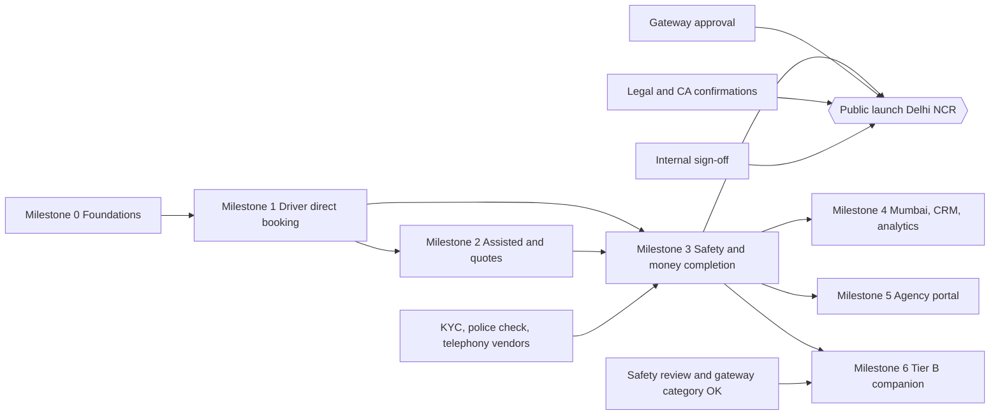

# Saathi: Implementation Roadmap

Status: Plan. Last updated: 27 October 2026.

Related documents: [module-catalog.md](module-catalog.md), [module-status.md](module-status.md), [decisions.md](decisions.md), [security-privacy-and-safety.md](security-privacy-and-safety.md), [booking-lifecycle.md](booking-lifecycle.md).

## Principles

- Build one connected, tested workflow at a time. Never generate the whole application in one step.
- Milestones 0 to 3 are pre-launch builds on staging with test users and sandbox payments.
- Real customers can book only after every control in master prompt section 7 is Verified (except Tier B-only items) and internal sign-off is recorded.
- Vendors that are not yet approved never block work. We build against the adapter interface with a sandbox or development adapter, label it in the UI and in [module-status.md](module-status.md), and list the vendor decision in the milestone report.
- A module is Verified only after its required tests have actually passed.

## Milestone overview

| Milestone | Theme | Main modules | Launch state at exit |
|---|---|---|---|
| 0 | Foundations and launch gates | M01, M02, M03 (cities and zones), M22, design system | Staging only |
| 1 | First end-to-end workflow: Personal driver, Delhi NCR, direct booking | M03, M04, M05, M06, M07, M08, M09, M10, M13, M16, M18, M19 (foundations), M20, M23 | Staging only, sandbox payments |
| 2 | Assisted matching and quotes; Event and business staff; multi-worker bookings | M07, M08, M09, M15, M18 | Staging only |
| 3 | Errands; full worker portal; payouts, refunds, disputes; SOS, live location, check-ins, masked calling, incidents; admin ops | M10, M13, M16, M18, M19 | Public launch gate for Delhi NCR |
| 4 | Mumbai go-live tooling, waitlists, basic CRM automations, analytics dashboards | M03, M15, M21, M23 | Mumbai opens when threshold met |
| 5 | Agency and partner portal | M11 | Agencies onboarded |
| 6 | Tier B companion category | M19, M03 | Enabled only after safety review and sign-off |
| Later | Corporate portal, subscriptions, WhatsApp Business, AI assistant and voice, Hindi content, mobile apps | M12, M14, M16, M17, i18n | Per decision |

## Milestone 0: Foundations and launch gates

**Modules touched:** M01, M02, M03 (cities, zones, regions only), M22, design system.

**Deliverables:**

- Repository setup with pnpm, TypeScript strict, ESLint, Prettier.
- Environments: local, staging, production. `.env.example` lists every variable. Startup validates env with Zod.
- Local Postgres 17 via embedded binaries (`pnpm db:local`), migrations (`pnpm db:migrate`), seed (`pnpm db:seed`).
- Database roles: owner role for migrations, `saathi_app` for the running app without BYPASSRLS. Row-level security switched on for tenant tables.
- CI on every pull request: type check, lint, tests (with an embedded Postgres cluster), build.
- i18n scaffolding: typed English catalogue, `t()` on server and client.
- Structured logger with personal data redaction. Error reporting adapter (logs now, Sentry pending vendor approval).
- Base design system tokens and core components from [design-system.md](design-system.md).
- Auth with phone OTP (dev SMS adapter), sessions, roles, organisations, audit log, rate limiting.
- Cities and zones as data: Delhi, Noida, Gurugram (region Delhi NCR) and Mumbai.
- Jobs table and `/api/cron/run`.
- Open items in [decisions.md](decisions.md): payment gateway category approval request, legal and CA items, vendor choices (SMS, KYC, telephony, payouts, error monitoring).

**Exit criteria:**

- Fresh clone to running app with documented commands.
- OTP login works end to end with the dev adapter. Rate limits and attempt limits tested.
- RLS proven with a test that runs SQL as `saathi_app` with another user's context and sees zero rows.
- CI green on the main branch.

## Milestone 1: Personal driver, Delhi NCR, direct booking

**Modules touched:** M03, M04, M05, M06, M07, M08, M09, M10, M13, M16, M18, M19 foundations, M20, M23.

**Deliverables:**

- Service catalogue with Personal driver configured for Delhi, Noida and Gurugram (and configured but not live for Mumbai).
- Worker registration, profile, service areas, document upload (driving licence with expiry, police verification, ID via manual KYC dev adapter), admin verification queue, per-category approval, availability.
- Customer search with filters, worker profile view, price breakdown.
- Booking with slot hold, sandbox payment through the webhook path, confirmation.
- Start and end OTP, completion, ledger entries, worker earnings record.
- Booking chat with leakage and prohibited-content filter.
- Two-way ratings, booking history (customer and worker), admin booking list and detail.
- City and service page for Delhi personal drivers with sitemap entry and the indexability rule.
- Code of conduct acceptance with stored version before first booking.
- Jobs: expire payment holds, document expiry sweep, notification outbox dispatch.

**Milestone 1 acceptance tests (all must pass):**

| # | Acceptance test (meaning as in the master prompt) | Test file |
|---|---|---|
| 1 | A customer cannot book a worker who is unverified, not approved for the category, outside the service area, or already booked for an overlapping slot. | `tests/acceptance/m1-eligibility.test.ts` |
| 2 | Two customers trying to book the same worker for the same slot at the same moment: exactly one succeeds. | `tests/acceptance/m1-concurrency.test.ts` |
| 3 | The price shown before payment equals the price snapshot stored on the booking, which equals the ledger entries. | `tests/acceptance/m1-price-integrity.test.ts` |
| 4 | Changing the service price after booking does not change the confirmed booking. | `tests/acceptance/m1-price-snapshot.test.ts` |
| 5 | Replaying the same payment webhook twice creates one payment, not two. | `tests/acceptance/m1-webhook-idempotency.test.ts` |
| 6 | A job cannot start without the correct customer OTP. | `tests/acceptance/m1-start-otp.test.ts` |
| 7 | A worker whose driving licence has expired disappears from driver search automatically. | `tests/acceptance/m1-document-expiry.test.ts` |
| 8 | Chat blocks a phone number typed into a message. | `tests/acceptance/m1-chat-filter.test.ts` |
| 9 | A worker cannot see another worker's bookings, and a customer cannot see another customer's bookings, even by calling the API directly. | `tests/acceptance/m1-data-isolation.test.ts` |
| 10 | The new city-service page appears in the sitemap within one deploy of going live, and is noindex when supply falls below the threshold. | `tests/acceptance/m1-seo-sitemap.test.ts` |

Notes on how each test proves the point:

- Test 2 runs two booking transactions on separate database connections at the same time against a real Postgres 17 cluster, so the row lock and the exclusion constraint are exercised for real.
- Test 5 posts the same signed webhook body twice through the HTTP route handler and counts payments and ledger journals.
- Test 9 calls the route handlers with another user's session cookie, and also runs SQL as `saathi_app` with another user's context, so both the API check and RLS are proven.
- Test 10 calls the sitemap and page metadata functions before and after supply crosses the threshold. Because both are computed from the database at request time, a page goes live without a redeploy, which satisfies "within one deploy".

**Exit criteria:** all ten tests pass in CI, the app builds, and [module-status.md](module-status.md) shows each M1 module at Tested or Verified with limitations written down.

## Milestone 2: Assisted matching and quotes, Event and business staff

**Modules touched:** M07 (service requests), M08 (quotes), M09 (manual dispatch, suggestions), M15 (basic leads), M18 (request and quote queues).

**Deliverables:** service request flow with first-response deadline, ops queue with owner and deadline, suggestions of eligible workers, quotes with 48-hour expiry, accept or change or decline, quote to booking with price snapshot, multi-worker bookings (several active assignments per booking), Event and business staff category configured.

**Exit criteria:** a request moves through every status with audit history; an accepted quote becomes a confirmed multi-worker booking; partial fill is visible to ops; tests for quote expiry and multi-worker overlap.

## Milestone 3: Errands, full worker portal, money and safety completion

**Modules touched:** M10, M13, M16, M18, M19, M03 (Errands category).

**Deliverables:** Errands and appointment assistance category; worker job offers with accept or decline (decline without penalty for safety); payouts through the real provider once approved (sandbox until then); refunds by cancellation policy; disputes with 48-hour window; SOS for customer and worker; live location sharing with emergency contact; scheduled safety check-ins with escalation; masked calling and messaging through a telephony adapter; incident handling with severity, owner and response deadlines; full admin operations; daily reconciliation report.

**Exit criteria:** every section 7 control (except Tier B-only items) is Verified, and internal sign-off is recorded. This is the public launch gate for Delhi NCR.

## Milestone 4: Mumbai tooling, waitlists, CRM, analytics

**Modules touched:** M03, M15, M21, M23.

**Deliverables:** waitlist capture and demand view by city and service, Mumbai go-live tooling (threshold dashboard, switch-on checklist), basic CRM automations (incomplete booking, pending quote, post-service feedback, repeat booking reminders) with consent and no duplicates, analytics dashboards from stored data, GA4 events with consent.

**Exit criteria:** Mumbai personal driver can go live automatically at threshold; automated messages never send twice in tests.

## Milestone 5: Agency and partner portal

**Modules touched:** M11, M02, M07, M13.

**Deliverables:** agency onboarding, agency-managed workers, allocation, fulfilment tracking, settlements, strict tenant isolation.

**Exit criteria:** cross-agency isolation proven through API and RLS tests.

## Milestone 6: Tier B companion category

**Modules touched:** M19, M03, M07, M16.

**Deliverables:** companion service configured with public-venue-only location rule, venue list or ops approval, 9 am to 10 pm window, 4-hour maximum, verified customers only, lower booking limit for new customers, scheduled check-ins, full prohibited-content enforcement.

**Exit criteria:** a written safety review confirms every section 5 and 7 control is implemented and tested, internal sign-off is recorded, and the payment gateway has confirmed the category in writing. Only then may an admin turn on the feature flag. This step needs your explicit approval.

## Later

Corporate portal (M12), subscriptions (M14), WhatsApp Business (M16), AI assistant and voice (M17), Hindi content and hreflang, React Native and Expo mobile apps.

## Critical path

The longest chain of dependent work to public launch is:

1. M01 foundations and M02 identity (Milestone 0).
2. M03 catalogue and M04 workers and verification.
3. M05 availability and M08 pricing.
4. M07 booking engine and M13 payments and ledger (sandbox).
5. M06 customer flow and M10 worker portal for one category (Milestone 1 tests green).
6. M19 safety completion, M16 masked calling, M13 refunds and payouts (Milestone 3).
7. External gates: gateway category approval, KYC and police verification vendor, telephony vendor, legal and CA confirmations, internal sign-off.

External gates run in parallel from Milestone 0, because they take calendar time that engineering cannot shorten.

## Dependency map

The module dependency graph is in [module-catalog.md](module-catalog.md). At milestone level:

## What blocks public launch

Public launch for Delhi NCR needs every item below. The checklist with status lives in [security-privacy-and-safety.md](security-privacy-and-safety.md).

1. **Section 7 safety controls:** phone OTP, worker identity verification through a licensed KYC provider or DigiLocker with consent, police verification before first booking, category documents with expiry and automatic suspension, selfie match and moderated photo, start and end OTP, live location sharing, SOS for both sides, safety check-ins for long bookings, masked calling and messaging, gender preference and decline without penalty, two-way ratings, complaints, incidents and disputes with severity, owners and deadlines.
2. **Payment gateway approval in writing** for the business model and each launch category, with live credentials, verified webhooks and end-to-end tests. Until then payments stay sandbox.
3. **Legal and CA items** in [decisions.md](decisions.md): DPDP Act 2023 and Rules compliance (notice, consent, retention, grievance officer), Aadhaar handling, GST on fees and commission, GST invoices, TDS on payouts, aggregator obligations under the labour codes, consumer protection terms (pricing, cancellation, refunds, grievance contact), terms of service and privacy notice. All are marked "Needs legal/CA confirmation" until confirmed.
4. **Vendor decisions:** SMS/OTP provider, KYC provider, police verification route, telephony (masked calls), payouts provider, error monitoring.
5. **Operations readiness:** incident response targets signed off (SOS acknowledged within 2 minutes, safety complaints within 1 hour, other complaints within 1 business day), on-call rota, runbooks, backup restore drill passed.
6. **Supply:** Delhi NCR personal driver pages go indexable only at or above the go-live threshold.
7. **Internal sign-off** recorded in [decisions.md](decisions.md).
