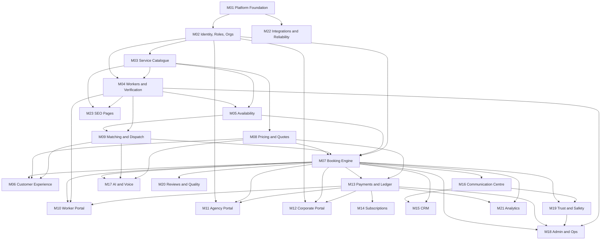

# Saathi: Module Catalogue

Status: Specification for v1. Last updated: 27 October 2026.

This catalogue lists all 23 modules. Each module lives in `src/modules/<module>` with its own schema, services and validation, and exposes HTTP route handlers under `/api/v1`. Shared infrastructure lives in `src/platform` (db, auth and session, logger, i18n, rate limiting, audit, adapters). Business logic never lives in UI components.

Related documents: [system-architecture.md](system-architecture.md), [database-design.md](database-design.md), [booking-lifecycle.md](booking-lifecycle.md), [roles-and-permissions.md](roles-and-permissions.md), [implementation-roadmap.md](implementation-roadmap.md), [module-status.md](module-status.md).

## How to read this catalogue

Every module entry covers responsibilities, key entities, services and APIs, permissions and validation, events, dependencies, tests, acceptance criteria and v1 status. "Definition of done" for every module is the shared one below, plus the module's own acceptance criteria.

### Shared definition of done

A module is done only when all of these are true (master prompt section 22):

1. Functionality is implemented and wired end to end, with no dead controls.
2. Data model and migrations are correct and applied cleanly on a fresh database.
3. Permissions and validation are enforced on the server, and row-level security covers tenant data.
4. Dependent modules integrate correctly.
5. Edge cases are handled, including loading, empty and error states.
6. Tests pass in CI (type check, lint, unit, integration, build).
7. Documentation and [module-status.md](module-status.md) are updated.
8. Remaining limitations are written down.

The tracker statuses are: Not Started, Specification Complete, In Progress, Implemented, Tested, Verified, Blocked. A module is Verified only after its required tests have actually passed.

### Event naming

Events are past-tense facts written to an `outbox_events` table in the same transaction as the change, for example `booking.confirmed`. Consumers are idempotent. Contracts will be detailed in `api-contracts.md` and `events-and-automation.md` when those modules start.

## Module dependency map

---

## M01 Platform Foundation

- **v1 status:** Yes.
- **Responsibilities:** repository layout, environment configuration with validation at startup, database connection and migrations, the request context (user, roles, request id), structured logger with personal data redaction, i18n message catalogue, error handling conventions, audit log service, rate limiter, jobs table and cron runner, outbox table, feature flags, CI pipeline.
- **Key entities:** `audit_logs`, `rate_limit_buckets`, `jobs`, `outbox_events`, `feature_flags`, `app_settings`.
- **Services and APIs:** `env` (Zod-validated), `db` (Drizzle over postgres.js; app role `saathi_app`), `withRequestContext(ctx, fn)` that opens a transaction and calls `set_config('app.user_id', ..., true)` and `set_config('app.roles', ..., true)`, `audit.record()`, `rateLimit.consume()`, `jobs.enqueue()` and `jobs.runDue()`, `t()` for strings, `logger`. Route `POST /api/cron/run` protected by `CRON_SECRET`. Health route `GET /api/health`.
- **Permissions and validation:** cron route rejects requests without the secret. Env validation fails the boot if a required secret is missing. Feature flags are read-only for non-admins.
- **Events:** emits `job.failed`. Consumes none.
- **Dependencies:** none.
- **Tests:** env validation, logger redaction (phone, email, OTP, tokens, Aadhaar-like numbers never appear in output), rate limiter windows, job idempotency (same unique key runs once), migrations apply on a fresh Postgres 17 cluster.
- **Acceptance criteria:** fresh clone runs `pnpm install`, `pnpm db:local`, `pnpm db:migrate`, `pnpm db:seed`, `pnpm dev`. CI runs type check, lint, tests and build on every pull request. No secret appears in client bundles or logs.

## M02 Identity, Users, Roles, Organisations

- **v1 status:** Yes.
- **Responsibilities:** phone OTP login and sign-up, sessions, account recovery, user roles, organisations (our own company, agencies, corporates), membership, code of conduct acceptance, consent records, account suspension.
- **Key entities:** `users`, `otp_challenges`, `sessions`, `user_roles`, `organisations`, `organisation_members`, `customer_profiles`, `conduct_acceptances`, `consent_records`, `account_restrictions`.
- **Services and APIs:** `POST /api/v1/auth/otp/request`, `POST /api/v1/auth/otp/verify`, `POST /api/v1/auth/logout`, `GET /api/v1/me`, `POST /api/v1/me/conduct-acceptance`, `POST /api/v1/me/consents`. Services: `requestOtp`, `verifyOtp`, `createSession`, `resolveSession`, `grantRole`, `suspendUser`.
- **Permissions and validation:** +91 phone numbers only, normalised to E.164. OTP is 6 digits, stored as an HMAC hash, expires after 5 minutes, allows 5 attempts. Rate limits per phone and per IP (see [security-privacy-and-safety.md](security-privacy-and-safety.md)). Sessions are opaque random tokens; only their hash is stored; cookies are httpOnly, Secure, SameSite=Lax. Role grants need `admin`. Fixed test OTP works only for listed test phones and never in production.
- **Events:** emits `user.registered`, `user.suspended`, `conduct.accepted`. Consumes `incident.escalated` (for suspension decisions by ops).
- **Dependencies:** M01, M16 (SMS adapter).
- **Tests:** OTP expiry, attempt limits, rate limits, wrong code, replayed code, session revocation, suspended user cannot act, role checks, conduct acceptance stores the version, test OTP disabled when `NODE_ENV=production`.
- **Acceptance criteria:** a new phone can sign up and sign in with OTP. A suspended user is blocked from every authenticated route. The accepted code of conduct version is stored before the first booking.

## M03 Configurable Service Catalogue

- **v1 status:** Yes.
- **Responsibilities:** cities, zones, regions, categories (with hierarchy and risk tier), services and their full configuration (section 11 of the master prompt), per-city availability, go-live thresholds, feature flags per category.
- **Key entities:** `regions`, `cities`, `zones`, `categories`, `services`, `service_city_settings`, `service_document_requirements`, `service_questions`, `cancellation_policies`.
- **Configuration per service:** name, description, images, parent category, booking mode (direct, assisted, both), pricing model and quote requirement, taxes, minimum and maximum duration, lead time, allowed hours, number of workers, location rules (customer address, public venue only, travel radius, outstation allowed), custom questions (validated JSON schema), required skills, documents, verification level, minimum rating, customer verification requirement, matching mode (auto or manual), cancellation policy, payment rule (prepay, deposit, pay after), safety rules (OTP start, check-in interval, SOS, public venue only), message templates, risk tier, go-live flag.
- **Services and APIs:** public `GET /api/v1/catalog/cities`, `GET /api/v1/catalog/services?city=`. Admin `POST/PATCH /api/v1/admin/services`, `.../cities`, `.../zones`. Service `getServiceConfig(serviceId, cityId)` returns a validated, typed config.
- **Permissions and validation:** writes need `catalog.manage`. Service config is validated with a Zod schema on write and on read. Tier B and C services cannot be enabled for booking unless the risk-tier feature flag is on, and turning that flag on needs the admin role plus a recorded sign-off reference.
- **Events:** emits `service.updated`, `service_city.went_live`, `service_city.went_dark`.
- **Dependencies:** M01, M02.
- **Tests:** config schema accepts valid configs and rejects invalid ones, Tier B cannot go live without the flag, Mumbai stays non-bookable below threshold, price change does not touch confirmed bookings (with M08).
- **Acceptance criteria:** Personal driver in Delhi NCR is fully configured by seed data, with no driver-specific code paths outside its config and a documented extension point for licence vehicle class.

## M04 Worker and Provider Management (incl. verification)

- **v1 status:** Yes.
- **Responsibilities:** worker registration and profile, skills, languages, experience, service areas (zones), category applications and per-category approval, document upload and verification queue, KYC result storage, police verification, selfie match status, profile photo moderation, document expiry tracking and automatic category suspension, strikes.
- **Key entities:** `worker_profiles`, `worker_service_areas`, `worker_skills`, `worker_languages`, `worker_category_approvals`, `worker_documents`, `document_files`, `kyc_verifications`, `worker_strikes`.
- **Services and APIs:** `POST /api/v1/worker/profile`, `POST /api/v1/worker/documents` (multipart), `POST /api/v1/worker/category-applications`, admin `GET /api/v1/admin/verification-queue`, `POST /api/v1/admin/documents/:id/decision`, `POST /api/v1/admin/category-approvals/:id/decision`, `GET /api/v1/admin/documents/:id/file` (streams decrypted file and writes an audit entry). Job `documents.expiry_sweep`.
- **Permissions and validation:** workers see only their own profile and documents (RLS). Verifiers can read documents only through the audited file route. Uploads accept JPEG, PNG and PDF up to a configured size, are virus-scan ready (adapter hook), encrypted with AES-256-GCM before storage. Aadhaar: only masked number and provider reference are stored, never the full number. Age must be 18 or over at registration.
- **Events:** emits `worker.registered`, `document.submitted`, `document.approved`, `document.rejected`, `document.expired`, `worker_category.approved`, `worker_category.suspended`.
- **Dependencies:** M01, M02, M03.
- **Tests:** unverified or unapproved worker excluded from search, expired licence excluded from driver search immediately (query-time check) and suspended by the sweep job, document access writes audit log, worker cannot read another worker's documents even through direct API calls.
- **Acceptance criteria:** a worker can register, upload a driving licence with expiry, be approved by a verifier for Personal driver, and appear in search. When the licence expiry date passes, the worker disappears from driver search without manual action.

## M05 Availability and Scheduling

- **v1 status:** Yes.
- **Responsibilities:** weekly working hours, date exceptions (time off), service areas by zone, conflict detection against active assignments, lead time and allowed hours enforcement.
- **Key entities:** `worker_weekly_hours`, `worker_time_off`, `booking_assignments` (shared with M07, holds the `slot` tstzrange and the exclusion constraint).
- **Services and APIs:** `GET/PUT /api/v1/worker/availability`, `POST /api/v1/worker/time-off`. Service `isAvailable(workerId, slot)` and `availableWorkers(serviceId, zoneId, slot)`.
- **Permissions and validation:** workers edit only their own availability. Times are entered in Asia/Kolkata and stored in UTC. Slots must respect service min and max duration, lead time and allowed hours.
- **Events:** emits `availability.updated`.
- **Dependencies:** M03, M04.
- **Tests:** working-hours boundaries, time-off exclusion, overlapping assignment exclusion, daylight-saving not applicable to IST but UTC conversion tested at midnight boundaries.
- **Acceptance criteria:** a worker already booked for an overlapping slot is never shown as bookable for that slot.

## M06 Customer Experience (website and account)

- **v1 status:** Yes.
- **Responsibilities:** home page, category and service pages, search and filter, worker profile view, booking flow with price breakdown, sandbox payment step, booking detail with start and end OTP display, chat, cancellation, booking history, favourites, ratings, account settings, report button.
- **Key entities:** reads from M03, M04, M05, M07, M08, M13. Owns `customer_favourites`.
- **Services and APIs:** server components call module services directly; client interactions call `/api/v1/*`. No business logic in components.
- **Permissions and validation:** customer pages that show bookings require a session and enforce ownership in the API and RLS. Forms validate with the same Zod schemas as the API. All strings through `t()`. Copy follows the rules in the master prompt section 6.
- **Events:** none directly (actions go through M07, M13, M20).
- **Dependencies:** M03, M04, M05, M07, M08, M09, M13, M16, M20, design system in [design-system.md](design-system.md).
- **Tests:** component tests for the price breakdown and OTP display, accessibility checks (labels, focus, contrast tokens), end-to-end booking flow through the API.
- **Acceptance criteria:** a customer can find a Delhi driver, see the breakdown, pay in sandbox, see the start OTP, chat with filtering, and rate after completion. Performance and accessibility budgets in [product-requirements.md](product-requirements.md) are met on customer pages.

## M07 Booking and Service Request Engine

- **v1 status:** Yes.
- **Responsibilities:** booking creation with re-validation, slot hold and expiry, confirmation on payment, start and end OTP, completion, cancellation by policy, status history; service requests and quote conversion from Milestone 2; multi-worker assignments from Milestone 2.
- **Key entities:** `bookings`, `booking_assignments`, `booking_status_history`, `booking_otps`, `service_requests` (M2), `booking_answers`.
- **Services and APIs:** `POST /api/v1/bookings` (create in pending_payment), `GET /api/v1/bookings/:id`, `GET /api/v1/bookings`, `POST /api/v1/bookings/:id/cancel`, `POST /api/v1/bookings/:id/start` (worker enters customer OTP), `POST /api/v1/bookings/:id/complete` (worker enters end OTP). Job `bookings.expire_holds`. State machine in [booking-lifecycle.md](booking-lifecycle.md).
- **Permissions and validation:** customers see only their bookings, workers see only bookings assigned to them, ops and admin see all (API checks plus RLS). Creation re-checks eligibility, availability, pricing and lead time inside one transaction with a lock on the worker row. A Postgres `EXCLUDE USING gist (worker_id WITH =, slot WITH &&) WHERE (status = 'active')` constraint is the final guard. Stale holds older than 15 minutes are expired in the same transaction before the insert. OTPs are hashed, 5 attempts each.
- **Events:** emits `booking.created`, `booking.confirmed`, `booking.started`, `booking.completed`, `booking.cancelled`, `booking.expired`. Consumes `payment.captured`, `document.expired` (flags future bookings for ops).
- **Dependencies:** M02, M03, M04, M05, M08, M09, M13.
- **Tests:** all Milestone 1 acceptance tests on booking (see [implementation-roadmap.md](implementation-roadmap.md)), illegal transitions rejected, concurrent booking race.
- **Acceptance criteria:** exactly one of two simultaneous bookings for the same worker and slot succeeds. A job cannot start without the correct customer OTP.

## M08 Pricing and Quotations

- **v1 status:** Yes.
- **Responsibilities:** pricing engine separate from the booking UI. Supports hourly, daily, fixed, duration-based, distance-based, custom quotes, add-ons, platform commission, agency-specific commission, coupons, cancellation fees, taxes and optional subscriptions. Produces a price breakdown and a snapshot of the rules used. Quotes from Milestone 2.
- **Key entities:** `pricing_rules` (per service and city, versioned), `tax_rules` (configuration), `coupons` (later), `quotes` (M2). Booking `price_snapshot` JSON.
- **Services and APIs:** `quote(serviceId, cityId, input)` returns line items in paise, totals, commission, worker earning, tax lines and the rule version ids. `GET /api/v1/pricing/preview`.
- **Permissions and validation:** pricing rule writes need `pricing.manage`. All arithmetic in integer paise with explicit rounding rules (round half up to the paisa, documented). No floating point. Tax rates and bases are configuration and marked "Needs CA confirmation".
- **Events:** emits `pricing_rule.updated`.
- **Dependencies:** M03.
- **Tests:** rounding, minimum duration, commission split, tax lines, snapshot immutability after a price change, preview equals snapshot equals ledger.
- **Acceptance criteria:** the price shown before payment equals the stored snapshot, which equals the ledger entries. Changing the service price after booking does not change the confirmed booking.

## M09 Matching and Dispatch

- **v1 status:** Yes (manual plus simple rules).
- **Responsibilities:** eligibility filter (single source of truth), ranking with simple rules (distance by zone, rating, acceptance rate, repeat-customer preference), manual dispatch by ops, unfilled job queue.
- **Key entities:** uses M04 and M05 tables. Owns `dispatch_actions` (from M2).
- **Services and APIs:** `eligibleWorkers(serviceId, cityId, zoneId, slot, filters)`, `GET /api/v1/search/workers`, admin `POST /api/v1/admin/bookings/:id/assign` (M2).
- **Permissions and validation:** public search returns only public profile fields. Filters are validated. Search is rate limited.
- **Events:** emits `dispatch.assigned` (M2), `dispatch.unfilled` (M2).
- **Dependencies:** M03, M04, M05.
- **Tests:** unverified, unapproved, out-of-area, expired-document and already-booked workers are excluded. Filters by language, gender and rating work.
- **Acceptance criteria:** search never returns a worker who would fail the booking-time eligibility check.

## M10 Worker Portal

- **v1 status:** Yes (web, mobile-first).
- **Responsibilities:** worker onboarding, profile, documents and verification status, availability, job list and details, start and end OTP entry, earnings and fees view, ratings, notifications; check-ins and SOS from Milestone 3.
- **Key entities:** reads M04, M05, M07, M13, M20.
- **Services and APIs:** `/worker/*` pages; uses `/api/v1/worker/*` and `/api/v1/bookings/*`.
- **Permissions and validation:** worker role required. Only own data (API and RLS). A worker can decline any booking without penalty when they feel unsafe (from M3 when offers exist).
- **Events:** none directly.
- **Dependencies:** M04, M05, M07, M13, M16.
- **Tests:** worker cannot see another worker's bookings even via direct API call; start fails with wrong OTP; earnings equal ledger worker payable lines.
- **Acceptance criteria:** a driver completes a job from start OTP to end OTP on a phone-sized screen, and sees the earning recorded.

## M11 Agency and Partner Portal

- **v1 status:** After v1 (Milestone 5).
- **Responsibilities:** agency onboarding, agency-managed workers, incoming assignments, allocation, fulfilment tracking, settlements.
- **Key entities:** `organisations` (type agency), `organisation_members`, `worker_profiles.organisation_id`, `agency_settlements`.
- **Permissions:** agency staff see only their organisation's workers and assignments (RLS by `organisation_id`). Agencies never see another agency's data.
- **Dependencies:** M02, M07, M13.
- **Tests:** cross-agency isolation via direct API and SQL under the app role.

## M12 Corporate Customer Portal

- **v1 status:** After v1 (Later).
- **Responsibilities:** company accounts, authorised bookers, approval rules, budgets, recurring bookings, consolidated GST invoices, usage reports.
- **Key entities:** `organisations` (type corporate), `corporate_bookers`, `approval_rules`, `budgets`, `recurring_bookings`.
- **Permissions:** corporate users never see another company's bookings (RLS).
- **Dependencies:** M02, M07, M13.

## M13 Payments, Ledger, Earnings, Payouts

- **v1 status:** Yes (core). Live payments blocked until gateway approval.
- **Responsibilities:** payment gateway adapter (sandbox now, Razorpay pending approval, Cashfree-ready interface), payment orders, webhook ingestion with signature verification and idempotency, double-entry ledger, worker earnings, refunds (M3), payouts adapter (M3), daily reconciliation report, GST invoice data.
- **Key entities:** `payment_orders`, `payments` (unique provider payment id), `webhook_events` (unique provider plus event id), `ledger_accounts`, `journal_entries`, `ledger_lines`, `worker_earnings` (view over ledger), `refunds` (M3), `payouts` (M3), `reconciliation_runs`.
- **Services and APIs:** `POST /api/v1/payments/orders` (for a booking), `POST /api/v1/webhooks/payments/:provider`, sandbox `POST /api/v1/sandbox/payments/:orderId/simulate` (non-production only, posts a signed webhook through the real ingestion path). Ledger service `post(journal)` validates balance. Database deferred constraint trigger rejects unbalanced journals at commit.
- **Ledger postings (M1):** on capture, debit gateway clearing and credit customer funds held, for the booking total. On completion, debit customer funds held and credit worker payable, commission revenue, platform fee revenue and tax payable as per the snapshot. Detailed in `pricing-and-finance.md` when M13 starts.
- **Permissions and validation:** webhooks verify HMAC signatures before any write. Sandbox endpoints return 404 in production. Finance role for ledger views. Customers see only their payments; workers only their earnings.
- **Events:** emits `payment.captured`, `payment.failed`, `refund.processed` (M3), `payout.sent` (M3). Consumes `booking.completed` (earnings), `booking.cancelled` (refunds, M3).
- **Dependencies:** M07, M08.
- **Tests:** replaying the same webhook twice creates one payment; tampered signature rejected; ledger always balances; ledger lines equal the snapshot; capture of an expired hold is handled (refund flag for ops).
- **Acceptance criteria:** sandbox payment flow confirms a booking through the same webhook path a real gateway will use, and the UI labels sandbox mode clearly.

## M14 Subscriptions and Monetisation

- **v1 status:** After v1.
- **Responsibilities:** optional customer or worker subscriptions, plan billing, benefits applied through M08.
- **Dependencies:** M08, M13.

## M15 CRM and Follow-up Automation

- **v1 status:** Basic in v1 (Milestone 4 for automations).
- **Responsibilities:** leads and enquiries, waitlist entries, source tracking, owner, reminders, follow-up templates, consent and channel preferences, deduplication, opt-outs, message log.
- **Key entities:** `leads`, `waitlist_entries`, `follow_up_rules`, `message_log`.
- **Permissions:** ops role. Messages respect consent and opt-out.
- **Dependencies:** M07, M16.
- **Tests:** a follow-up never sends twice (unique idempotency key), opt-out respected.

## M16 Communication Centre

- **v1 status:** Yes (email, SMS, in-app, masked calling).
- **Responsibilities:** channel adapters (SMS, email, push later, WhatsApp later, masked calling), notification templates through i18n, notification outbox with idempotency and retries, in-app booking chat with leakage and prohibited-content moderation.
- **Key entities:** `notifications` (outbox with unique `idempotency_key`), `notification_templates`, `chat_threads`, `chat_messages`, `moderation_flags`, `prohibited_terms`.
- **Services and APIs:** `notify(templateKey, recipient, data, idempotencyKey)`, `GET/POST /api/v1/bookings/:id/messages`, job `notifications.dispatch`. Adapters: `DevSmsAdapter` (writes to log and outbox, never sends), `DevEmailAdapter`, masked calling pending vendor.
- **Permissions and validation:** only the booking's customer, assigned worker, and ops can read or post in its thread (API and RLS). Message text is checked by the moderation filter before storage: phone numbers (including spaced digits and number words), emails, UPI IDs, URLs and payment links, social handles, and prohibited terms. Severity decides block or queue for moderation. Blocked messages return a polite explanation and are not delivered.
- **Events:** emits `chat.message_blocked`, `chat.message_flagged`, `notification.sent`, `notification.failed`. Consumes booking events for templates.
- **Dependencies:** M01, M02, M07.
- **Tests:** a phone number typed in chat is blocked, including "98 1234 5678" and "nine eight one..." forms; email and UPI blocked; normal messages pass; notification sent once even if the job runs twice.
- **Acceptance criteria:** chat blocks a phone number typed into a message. No real phone number is ever shown to the other party.

## M17 AI and Voice Assistant

- **v1 status:** After v1.
- **Responsibilities:** natural-language intake, follow-up questions, category selection, enquiry creation through authorised backend functions only. Never invents prices, availability, qualifications, identities or confirmations. Explicit confirmation before booking or charging.
- **Dependencies:** M07, M08, M09, M16.

## M18 Admin and Operations

- **v1 status:** Yes (core).
- **Responsibilities:** admin and ops dashboard: users, workers, verification queue, cities and zones, categories and services, pricing, bookings list and detail, payments and ledger views, moderation queue, incidents and SOS (M3), audit log viewer, feature flags, settings.
- **Key entities:** reads most modules. Owns `admin_notes`.
- **Services and APIs:** `/admin/*` pages; `/api/v1/admin/*` routes. Every list has real search, filters and pagination.
- **Permissions and validation:** permission matrix in [roles-and-permissions.md](roles-and-permissions.md). Every write records an audit log entry with actor, action, target and before and after values (personal data redacted where needed).
- **Events:** emits whatever the underlying module emits.
- **Dependencies:** M02, M03, M04, M07, M13, M19.
- **Tests:** a non-admin calling admin APIs gets 403; audit entries are written for every admin write; lists paginate correctly.
- **Acceptance criteria:** ops can see every booking with status history, and verifiers can clear the verification queue end to end.

## M19 Trust, Safety, Disputes

- **v1 status:** Yes (all of section 7 before public launch). Milestone 1 delivers the foundations; Milestone 3 completes it.
- **Responsibilities:** code of conduct versions, reports, complaints, incidents with severity, owner and response deadlines, SOS, live location sharing, safety check-ins, gender preference, worker decline without penalty, disputes and dispute window, prohibited-content queue, suspensions, off-platform leakage flags.
- **Key entities:** `conduct_versions`, `reports`, `complaints`, `incidents`, `sos_events`, `location_shares`, `safety_checkins`, `disputes`, `leakage_flags`.
- **Services and APIs:** `POST /api/v1/reports`, `POST /api/v1/bookings/:id/sos` (M3), `POST /api/v1/complaints`, admin incident queue.
- **Permissions and validation:** reporters see only their own reports; ops see all; every incident change is audited.
- **Events:** emits `report.created`, `incident.created`, `sos.triggered`, `incident.escalated`, `dispute.opened`. Consumes `chat.message_blocked` (repeat-violation counting), `review.low_rating`.
- **Dependencies:** M02, M07, M16.
- **Tests:** repeat violations trigger suspension and an audit entry; SOS creates a priority incident and notifies (M3).
- **Acceptance criteria:** every control in master prompt section 7 is Verified before public launch. See the gate checklist in [security-privacy-and-safety.md](security-privacy-and-safety.md).

## M20 Reviews and Quality

- **v1 status:** Yes.
- **Responsibilities:** two-way ratings, review text moderation, reviews only after completed bookings, worker quality score, low-rating flags routed to quality review.
- **Key entities:** `reviews` (unique per booking and author), `quality_scores`, `quality_flags`.
- **Services and APIs:** `POST /api/v1/bookings/:id/review`, `GET /api/v1/workers/:id/reviews`.
- **Permissions and validation:** only the booking's customer or worker can review, only once, only after completion. Review text passes the same moderation filter as chat.
- **Events:** emits `review.created`, `review.low_rating`.
- **Dependencies:** M07, M16, M19.
- **Tests:** cannot review before completion; cannot review twice; low rating creates a quality flag.
- **Acceptance criteria:** a customer rates a completed booking and the worker's displayed rating updates from stored data.

## M21 Analytics and Reporting

- **v1 status:** Basic in v1.
- **Responsibilities:** booking counts, funnel, revenue and commission from the ledger, payouts outstanding, utilisation, cancellations, waitlist demand by city and service, safety incident counts. GA4 events with consent.
- **Dependencies:** M07, M13, M15.
- **Rule:** all figures come from stored data or are clearly labelled sample data.

## M22 Integrations, Monitoring, Reliability

- **v1 status:** Yes.
- **Responsibilities:** adapter registry with sandbox labelling, error reporting adapter (structured logs now, Sentry pending vendor approval), uptime check endpoint, backup and restore runbook with a tested restore, environment separation (local, staging, production), secrets management, webhook signature verification helpers, retry and idempotency helpers.
- **Key entities:** `integration_settings`, `webhook_events` (shared with M13).
- **Services and APIs:** `GET /api/health`, `adapters.status()` shown in admin and in a sandbox banner.
- **Tests:** adapters report sandbox mode; health endpoint checks the database; restore drill documented with the date it last passed.
- **Acceptance criteria:** every unconfigured integration is visibly labelled sandbox in the UI and in [module-status.md](module-status.md).

## M23 SEO and City/Service Pages

- **v1 status:** Yes.
- **Responsibilities:** server-rendered `/[city]/[service]` pages from the database, indexability rule (indexable only when verified active eligible worker count is at or above the threshold), noindex plus waitlist and assisted request below threshold, unique titles and descriptions, one H1, structured data (Organization, Service, BreadcrumbList; FAQPage only for a visible FAQ; no review markup without real visible reviews), dynamic `sitemap.xml` and `robots.txt`, canonical tags, worker profiles noindex by default, hreflang-ready.
- **Key entities:** reads M03 and M04. Owns `seo_overrides` (optional copy per page).
- **Services and APIs:** `cityServicePageState(citySlug, serviceSlug)` returns `{ indexable, supplyCount, threshold }`; `app/sitemap.ts` lists only indexable pages; `generateMetadata` sets robots per page.
- **Permissions and validation:** content edits need `catalog.manage`.
- **Events:** consumes `worker_category.approved`, `worker_category.suspended`, `document.expired` (page state is computed at request time, so no cache invalidation is needed for correctness).
- **Dependencies:** M03, M04.
- **Tests:** page is noindex below threshold, indexable at threshold, and appears in or disappears from the sitemap accordingly.
- **Acceptance criteria:** the Delhi personal driver page appears in the sitemap within one deploy of going live, and is noindex when supply falls below the threshold.
