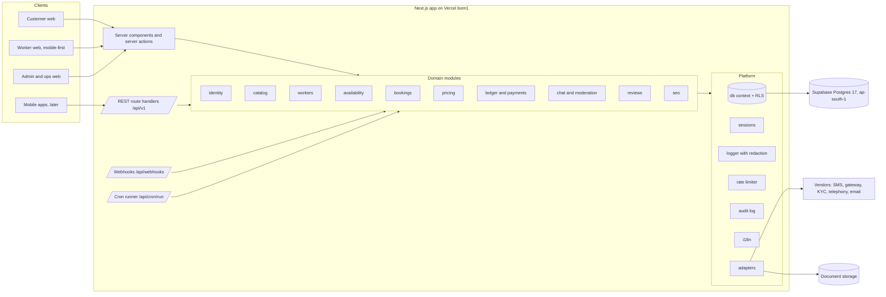

# System architecture

Status: Specification Complete (Milestone 0). Owner: tech lead. Last updated 27 October 2026.

Related: [database-design.md](database-design.md), [booking-lifecycle.md](booking-lifecycle.md), [roles-and-permissions.md](roles-and-permissions.md), [security-privacy-and-safety.md](security-privacy-and-safety.md), [decisions.md](decisions.md).

## 1. Shape of the system

Saathi is a **modular monolith**: one Next.js application, one PostgreSQL database, a small set of background jobs, and adapters for every external vendor. The repository was empty on 27 October 2026, so there was no existing stack to preserve. A monolith fits the team size and the launch scope. Module boundaries are kept strict so a module can later move out into its own service if load or team structure demands it.



## 2. Technology choices

| Concern | Choice | Version | Why |
|---|---|---|---|
| Web framework | Next.js App Router | 16.4.3 | Server rendering for SEO, route handlers for the mobile-ready API, one deployable. |
| UI runtime | React | 19.3.1 | Server components keep customer pages light on mid-range Android. |
| Language | TypeScript, strict | 5.9.3 | TypeScript 7 (native compiler) was released but Next.js build-time type checks are not yet proven against it. Revisit in Milestone 3. |
| Styling | Tailwind CSS with design tokens | 4.3.3 | Tokens from [design-system.md](design-system.md) live in one `@theme` block. No default template look. |
| Database | PostgreSQL | 17 | Exclusion constraints, row-level security, transactional integrity for money. |
| ORM and migrations | Drizzle ORM and drizzle-kit | 0.45.4 / 0.31.11 | Typed SQL close to the metal, plain SQL migrations we can review, no runtime engine. |
| Driver | postgres.js | 3.4.9 | Works with the Supabase transaction pooler (`prepare: false`). |
| Validation | Zod | 4.6.7 | One schema shared by server actions, API handlers and service config. |
| Tests | Vitest against real Postgres | 5.0.5 | Acceptance tests run against the same database engine as production. |
| Package manager | pnpm | 10.29.1 | Strict dependency graph, build scripts allowed only for listed packages. |
| Hosting | Vercel, region bom1 (Mumbai) | n/a | Existing account. Close to users. |
| Database hosting | Supabase Postgres, region ap-south-1 (Mumbai) | n/a | Existing account. Storage is also used for documents once access is granted. |

### Local development and tests

The development machine has no Docker and no system Postgres. We use real PostgreSQL 17 binaries shipped as npm packages (`@embedded-postgres/windows-x64` and `@embedded-postgres/linux-x64`). Our own scripts drive them with `initdb` and `pg_ctl`. We use `pg_ctl` rather than starting `postgres` directly because, on Windows, `pg_ctl` drops administrator rights, which Postgres requires. This gives tests the real engine: exclusion constraints, RLS, `btree_gist` and `pgcrypto` all behave as in production.

- `pnpm db:local` starts a persistent local cluster in `.local/pgdata` on port 54329.
- Vitest's global setup starts a throwaway cluster in a temp directory on a free port, runs migrations, and removes it afterwards.

## 3. Code layout and boundaries

```
src/
  app/                    Next.js routes only: pages, layouts, route handlers, server actions
    (site)/               customer pages, city/service landing pages
    worker/               worker portal (mobile-first)
    admin/                admin and ops dashboard
    api/v1/               REST API for web and future mobile apps
    api/webhooks/         payment gateway webhooks
    api/cron/             job runner endpoint
  modules/<name>/         domain modules
    schema.ts             Drizzle tables owned by the module
    service.ts            domain logic; the only place that changes state
    validation.ts         Zod schemas for inputs and config
    queries.ts            read models for pages and APIs
  platform/               cross-cutting infrastructure
    db/                   connection pools, withDb(ctx) transaction wrapper that sets RLS context
    auth/                 OTP challenges, sessions, current-user helpers
    adapters/             sms, payments, kyc, storage, email, telephony, error reporting
    audit.ts, logger.ts, rate-limit.ts, crypto.ts, config.ts, errors.ts
  i18n/                   message catalogues and t()
  ui/                     presentational components only, no data access
drizzle/                  generated and hand-written SQL migrations
scripts/                  local db, migrate, seed, run jobs
tests/                    unit, integration and acceptance tests
docs/                     specifications, decisions, tracker
```

Rules, enforced by ESLint `no-restricted-imports` where possible:

1. `src/ui` and `src/app` never import `postgres` or Drizzle tables directly. Pages call `queries.ts`; mutations call `service.ts`.
2. `src/modules/*` never import from `src/app` or `src/ui`.
3. A module may call another module's `service.ts` or `queries.ts`, never its tables, except through documented read joins listed in [database-design.md](database-design.md).
4. Every input crossing a trust boundary (form, API body, webhook, query string) is parsed with Zod before reaching a service.
5. Services receive a `Ctx` (current user id, roles, request id) and run inside `withDb(ctx, tx => ...)`, which opens a transaction and sets the RLS context. There is no way to obtain a database handle without a context.

## 4. Request flow and the security context

```mermaid
sequenceDiagram
  participant B as Browser or app
  participant H as Route handler / server action
  participant S as Domain service
  participant P as Postgres (role saathi_app)
  B->>H: request + session cookie
  H->>H: resolve session (hash lookup), build Ctx, rate limit
  H->>H: Zod parse input
  H->>S: service(ctx, input)
  S->>P: BEGIN; set_config('app.user_id', ctx.userId, true); set_config('app.roles', 'customer', true)
  S->>P: queries (RLS filters rows), row locks, inserts
  S->>P: insert audit_log
  S->>P: COMMIT
  S-->>H: result
  H-->>B: response (no internal ids of other users, no secrets)
```

- **Two database roles.** Migrations run as the owner role. The application connects as `saathi_app`, which is not the table owner and has no `BYPASSRLS`. Row-level security therefore applies to every application query.
- **System context.** Webhooks and jobs run with `app.roles = 'system'`, which RLS policies recognise explicitly. The system context is only constructed inside webhook and cron handlers after signature or secret verification.
- **Authorisation is checked twice.** The service checks the permission matrix in [roles-and-permissions.md](roles-and-permissions.md), and RLS independently restricts which rows the role can read or change.

## 5. Adapters and sandbox modes

Every external vendor sits behind an interface in `src/platform/adapters`. The active implementation is chosen by environment variable. Unconfigured or sandbox adapters announce themselves in the UI with a visible "Sandbox" label, and in [module-status.md](module-status.md).

| Adapter | Interface | Implementation now | Production candidate (vendor decision pending) |
|---|---|---|---|
| SMS / OTP delivery | `SmsSender` | `dev-log`: writes to the notification outbox and server log; test phones listed in `DEV_TEST_PHONES` use fixed code 123456 outside production | MSG91, Gupshup, Twilio (DLT registration needed in India) |
| Payments | `PaymentGateway` | `sandbox`: creates orders, simulates checkout, delivers HMAC-signed webhooks through the same verification path as live | Razorpay (primary), Cashfree (second) |
| Payouts | `PayoutProvider` | not started (Milestone 3) | RazorpayX, Cashfree Payouts |
| KYC | `KycProvider` | `manual`: verifier reviews uploaded ID in the admin queue; stores masked number and a local reference only | DigiLocker via a licensed partner, or a licensed KYC vendor |
| Document storage | `DocumentStore` | `local-encrypted`: AES-256-GCM encrypted files under `.local/documents` | Supabase Storage private bucket, still encrypted app-side |
| Email | `EmailSender` | `dev-log` | Pending |
| Masked calling | `Telephony` | not started (Milestone 3) | Exotel, Knowlarity, Twilio |
| Error reporting | `ErrorReporter` | structured log only | Sentry (new vendor, needs approval) |

## 6. Background jobs

Vercel functions are short-lived, so there is no always-on worker. In Milestone 1 the `/api/cron/run` endpoint, protected by `CRON_SECRET`, runs the three recurring sweeps below; each is idempotent and safe to run at any time. `vercel.json` schedules it every minute (per-minute cron needs a paid Vercel plan; on the free plan it can run at most daily, which still keeps correctness because eligibility checks dates directly). Locally, `pnpm jobs:run` does the same. A `jobs` table with a unique `dedupe_key` exists for one-off deferred jobs; nothing enqueues into it yet, and claiming with `FOR UPDATE SKIP LOCKED` will be added when the first one-off job type lands (Milestone 2 quote expiry).

| Job | Schedule | Effect |
|---|---|---|
| `expire-payment-holds` | every minute | Moves `pending_payment` bookings past `hold_expires_at` to `expired` and releases the worker slot. |
| `document-expiry-sweep` | hourly | Marks documents past `expires_on` as `expired`, suspends the dependent category approval, notifies the worker. Search already excludes expired documents by date, so correctness never depends on this job running on time. |
| `dispatch-notifications` | every minute | Sends pending outbox rows through the channel adapter. Each row has a unique idempotency key and is never sent twice. |

## 7. Environments and configuration

| Environment | Database | Payments | SMS | Who uses it |
|---|---|---|---|---|
| local | local Postgres 17 (`pnpm db:local`) | sandbox | dev-log | developers |
| test | throwaway Postgres 17 per test run | sandbox | dev-log | Vitest, CI |
| staging | Supabase project (staging) | sandbox | dev-log or vendor test mode | internal testers, test users only |
| production | Supabase project (production) | live only after gateway approval and sign-off | vendor | real users, after launch gate |

All secrets are environment variables, listed with descriptions in `.env.example`. None are read in client components. Business values from section 16 of the brief (commission, minimum hours, lead time, cancellation windows) live in the database as configuration, editable per city and service.

## 8. Reliability and operations

- **CI** on every pull request: install, type check, lint, tests against real Postgres, production build (`.github/workflows/ci.yml`).
- **Health check:** `GET /api/health` checks the database round trip. Uptime monitoring is a vendor decision.
- **Logs:** JSON lines with request id. Phone numbers, OTPs, tokens, document numbers, addresses and message bodies are redacted by the logger.
- **Backups:** Supabase daily backups plus point-in-time recovery on the paid plan. A restore drill is a Milestone 3 exit criterion.
- **Rate limits:** Postgres fixed-window counters, so limits hold across serverless instances.

## 9. Mobile readiness

Every customer and worker action the web UI performs is also exposed under `/api/v1` with JSON in and out, the same Zod schemas, and the same services. Sessions work with a bearer token as well as the cookie, so React Native clients can use the API later without a new backend.
